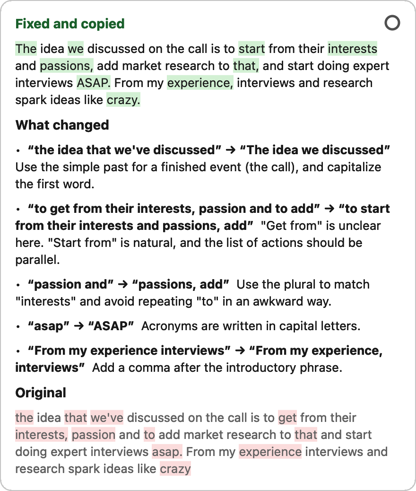

# Proofread Hotkey

A small free app for Mac. You press one keyboard shortcut in any app, and your own Claude or Codex fixes the English in your text. (Codex is the same kind of assistant from OpenAI; it works on a ChatGPT subscription.) A small window in the top-right corner shows what was changed and why, so you learn from every fix.

You need a Claude or ChatGPT subscription and one extra free program. The section "What you need" tells how to install it.

[Читать по-русски](README.ru.md)



## What happens when you press the shortcut

1. You write a text anywhere: in a browser, in Slack, in Mail, in a chat.
2. You copy the text (Command + C) and press **Command + Shift + ;** (the key with the semicolon). If you let the app press Command + C for you (see "Select the text instead of copying it"), you only select the text and press the shortcut.
3. The app gives the text to Claude or Codex. It uses Claude Code or Codex CLI. These are separate programs, not the usual Claude and ChatGPT apps, and you install one of them once (see "What you need"). The program is signed in with your account, so everything works on your existing subscription. You do not need a separate paid developer account, and you do not pay per request.
4. While the check runs, a small window in the top-right corner of the screen says "Checking with Claude…" (or "Checking with Codex…") and shows your text. The check takes 4 to 10 seconds.
5. Then the corrected text is copied for you, the same as if you had pressed Command + C on it. It replaces the text you copied before. You paste it (Command + V) wherever you want. The app never pastes, sends or publishes anything by itself.
6. The window now shows three things:
   - the corrected text, where every new word has a green background;
   - the list "What changed": what you wrote, what it became, and a short reason, for example *“asap” → “ASAP”. Acronyms are written in capitals*;
   - your original text, where every replaced word has a red background.

   If the text has no mistakes, the window says "No edits needed — copied".
7. The window closes by itself after 5 seconds. A small ring in its top-right corner shows how much time is left. Put the mouse pointer over the window and the ring stops: the window stays while you read. Move the pointer away and the countdown goes on. A click on the window closes it at once.

The window never becomes the active window. What you type still goes to the app you work in.

The words in the app's window and menu are in English and cannot be changed. The explanations of the edits are in English too, but you can change their language, see "Change the rules of proofreading".

## What you need

- A Mac with macOS 13 or newer.
- One of these two programs. Both are programs that you use by typing in the Terminal app, and each works on a subscription you may already have:
  - **Claude Code** from Anthropic (the `claude` command). It works with a Claude Pro or Max subscription.
  - **Codex CLI** from OpenAI (the `codex` command). It works with a paid ChatGPT subscription.

To install Claude Code, open the Terminal app: press Command + Space, type "Terminal", press Return. Paste this line and press Return:

```
curl -fsSL https://claude.ai/install.sh | bash
```

Wait until the Terminal says that the install is finished. If the line does not work, the current instructions are on https://claude.com/claude-code. For Codex CLI, follow the install steps on https://github.com/openai/codex.

Then sign in once. In the Terminal app type `claude` (or `codex`), press Return and follow the steps on the screen: the program asks you to sign in with the account that has your subscription. When the sign-in is done, you can close the Terminal window. The app does not need it open.

If you have both programs, the app uses Claude. You can switch in the app's menu.

## Install: ask your Claude to do it

There are two ways to install the app. Choose one. This one is easier: Claude does everything. The next section is for people who want to run the commands themselves.

1. Open the Terminal app: press Command + Space, type "Terminal", press Return.
2. Type `claude` (or `codex`) and press Return.
3. Paste this message and press Return:

```
Install Proofread Hotkey on my Mac: clone https://github.com/zamesin/proofread-hotkey and follow the AGENTS.md file in it.
```

Claude downloads the files into the folder `proofread-hotkey` in your home folder, installs the app, starts it, checks that it works and tells you what to do next. This takes about a minute. Claude may ask for your permission to run commands: allow them. When Claude says that it is done, you can close the Terminal window.

## Install: do it yourself

Open the Terminal app (press Command + Space, type "Terminal", press Return). Paste these three lines one by one, and press Return after each line:

```
git clone https://github.com/zamesin/proofread-hotkey.git ~/proofread-hotkey
cd ~/proofread-hotkey
./install.sh
```

If macOS offers to install the "command line developer tools" after the first line, agree, wait until the install ends, and paste the first line again.

The third line puts **Proofread Hotkey** into your Applications folder and starts it. After that you can close the Terminal window.

## Check that it works

After the install you see a new icon in the menu bar at the top of the screen: lines of text with a check mark. Copy any English text, press Command + Shift + ; and look at the top-right corner of the screen. The window with the corrected text appears there.

## Select the text instead of copying it

Right after the install the order is: you copy the text, then you press the shortcut. To skip the copying, let the app press Command + C for you:

1. Click the app's icon in the menu bar.
2. Choose **Take the selected text without ⌘C: allow…** (⌘ is the Command key).
3. macOS opens System Settings → Privacy & Security → Accessibility. Turn on the switch next to Proofread Hotkey.

Now you select a text and press the shortcut. If the app still checks the old text, choose **Quit** in its menu and open Proofread Hotkey from the Applications folder again.

The app needs this permission only to press Command + C in the active window. Without the permission everything else works the same.

## The menu

Click the icon in the menu bar to see the menu:

- **Proofread** — the same as the shortcut.
- **Show the last changes** — opens the last window again, if 5 seconds were not enough.
- **Hotkey: ⇧⌘;. Change…** (⇧ is the Shift key, ⌘ is the Command key) — a small window appears. Press the new shortcut in it: two keys such as Command + Shift or Control + Option, plus one more key. The new shortcut replaces Command + Shift + ;.
- **Checks with** — choose Claude or Codex.
- **Edit the prompt…** — opens the text of the rules that the app gives to Claude or Codex. See the next section.
- **Start at login** — the app starts by itself when you turn on the Mac. It is on after the install.
- **Quit**.

## Change the rules of proofreading

The app gives Claude or Codex a text with rules: fix grammar, spelling and unnatural phrases; keep the meaning, the tone and the line breaks; translate words from another language that are mixed into an English text; explain every edit in plain English.

To change the rules, choose **Edit the prompt…** in the app's menu. A file with the rules opens in TextEdit. Edit it and save. The next check uses the new text. For example, you can ask for British English, or for explanations in your own language.

The last paragraphs of the file tell Claude to answer in two parts with the line `===CHANGES===` between them: the corrected text above the line, the list of changes below it. Do not change these paragraphs. Without them the app cannot show the list "What changed".

To go back to the built-in rules, delete the file: in Finder choose Go → Go to Folder…, paste `~/Library/Application Support/Proofread Hotkey`, press Return and move `prompt.txt` to the Trash.

## What happens to your text

- Your text goes only to the Claude or Codex program on your Mac, and from it to Anthropic or OpenAI under your own account, the same as when you use these programs yourself.
- The app has no server and collects nothing.
- The app starts Claude or Codex in a mode where it cannot open your files or run commands. It only reads the text you sent and answers.
- The app keeps a log file, `~/Library/Logs/ProofreadHotkey.log`. It holds technical lines only: the time, the length of the text, how long the check took. It does not hold your texts.

## Update and uninstall

To update, open the Terminal app and paste these lines one by one, with Return after each:

```
cd ~/proofread-hotkey
git pull
./install.sh
```

After an update macOS may forget that you let the app press Command + C. You notice this when you select a new text, press the shortcut, and the app checks an old text. Open System Settings → Privacy & Security → Accessibility, select the Proofread Hotkey line and remove it with the minus button. Then choose **Take the selected text without ⌘C: allow…** in the app's menu again.

To uninstall: click the app's icon in the menu bar and choose **Start at login** so that the check mark next to it disappears. Then choose **Quit** in the same menu and move Proofread Hotkey from the Applications folder to the Trash. Three things stay on the disk, and you can delete them too: the folder `proofread-hotkey` in your home folder, the log file `~/Library/Logs/ProofreadHotkey.log` and, if you changed the rules, the file `prompt.txt` in the folder `~/Library/Application Support/Proofread Hotkey` (the section "Change the rules of proofreading" tells how to open this folder).

## If something does not work

- **The install ended with an error, or the icon did not appear.** Open the Terminal app, type `claude`, press Return and paste: "The install of Proofread Hotkey from ~/proofread-hotkey failed. Find out why and fix it." If this does not help, describe what you saw at https://github.com/zamesin/proofread-hotkey/issues
- **Nothing happens when I press the shortcut.** Check that the icon is in the menu bar. If it is not, open Proofread Hotkey from the Applications folder. If the icon is there, another app may use the same shortcut: choose another one in the menu.
- **The window says "The `claude` command was not found…" (or the same about `codex`).** Install Claude Code or Codex CLI and sign in, as the section "What you need" says. Then press the shortcut again.
- **The window says "Claude could not check the text." (or the same about Codex).** Open the Terminal app, type `claude` (or `codex`) and press Return. You will see whether you are signed in and whether your subscription is active.
- **The app checked an old text.** If you copy the text yourself: you pressed the shortcut without copying the new text. Copy first. If you let the app press Command + C for you: choose **Quit** in the menu and open the app again. If that does not help, macOS forgot the permission: open System Settings → Privacy & Security → Accessibility, remove Proofread Hotkey with the minus button and choose **Take the selected text without ⌘C: allow…** in the app's menu again.
- **The window says "The text is too long…".** The app takes texts up to 6000 characters. Check a longer text in parts.

## License

Free to use, copy and change. The license is MIT, see [LICENSE](LICENSE).
