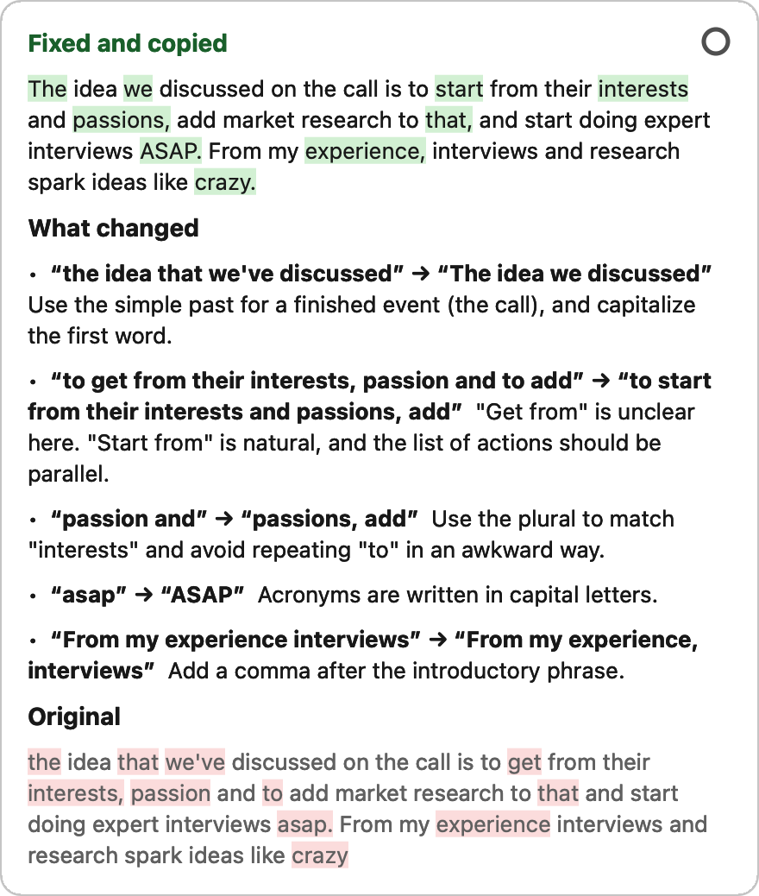

# Proofread Hotkey

Маленькое бесплатное приложение для Mac. Вы нажимаете одно сочетание клавиш в любой программе, и ваш собственный Claude или Codex исправляет английский в вашем тексте. Маленькое окошко в правом верхнем углу экрана показывает, что исправлено и почему. Так вы учитесь на каждой правке.

[Read in English](README.md)



## Что происходит, когда вы нажимаете сочетание клавиш

1. Вы пишете текст где угодно: в браузере, в Slack, в Почте, в чате.
2. Вы копируете текст (Command + C) и нажимаете **Command + Shift + ;** (клавиша с точкой с запятой; в русской раскладке на ней буква «Ж»). Если дать приложению одно разрешение, о нём ниже, копировать не нужно: вы выделяете текст и нажимаете сочетание.
3. Приложение отдаёт текст Claude или Codex. Оно использует программу для командной строки, которая уже установлена на вашем Mac и в которую вы уже вошли. Поэтому всё работает на вашей подписке. Ключ API не нужен, и за каждый запрос вы не платите.
4. Через несколько секунд исправленный текст лежит в буфере обмена. Вы вставляете его (Command + V) туда, куда нужно. Само приложение никуда ничего не вставляет, не отправляет и не публикует.
5. В правом верхнем углу экрана появляется окошко. В нём три части:
   - исправленный текст, где каждое новое слово стоит на зелёном фоне;
   - список «What changed» («Что изменилось»): что вы написали, чем это стало и короткая причина, например *“asap” → “ASAP”. Acronyms are written in capitals* («Сокращения из первых букв пишут заглавными»);
   - ваш исходный текст, где каждое заменённое слово стоит на красном фоне.
6. Окошко закрывается само через 5 секунд. Маленькое кольцо в его правом верхнем углу показывает, сколько времени осталось. Наведите мышь на окошко, и кольцо остановится: окошко остаётся, пока вы читаете. Уберите мышь, и отсчёт пойдёт дальше. Щелчок по окошку закрывает его сразу.

Окошко не забирает клавиатуру и фокус у программы, в которой вы работаете. Вы можете печатать дальше, пока оно на экране.

Надписи в приложении и объяснения правок — на английском. Язык объяснений можно поменять, об этом в разделе «Как поменять правила проверки».

## Что нужно

- Mac с macOS 13 или новее.
- Одна из двух программ, установленная и со входом по вашей подписке:
  - **Claude Code** — программа для командной строки от Anthropic (команда `claude`). Работает с подпиской Claude Pro или Max.
  - **Codex CLI** — программа для командной строки от OpenAI (команда `codex`). Работает с подпиской ChatGPT.

Если есть обе, приложение использует Claude. Переключить можно в меню приложения.

## Установка: попросите свой Claude

Откройте Claude Code (или Codex) в терминале и вставьте это сообщение:

```
Install Proofread Hotkey on my Mac: clone https://github.com/zamesin/proofread-hotkey and follow the AGENTS.md file in it.
```

Claude скачает приложение, установит его, запустит, проверит, что оно работает, и скажет, что делать дальше. Это занимает около минуты.

## Установка: своими руками

Откройте программу «Терминал» и выполните три команды:

```
git clone https://github.com/zamesin/proofread-hotkey.git ~/proofread-hotkey
cd ~/proofread-hotkey
./install.sh
```

Скрипт кладёт **Proofread Hotkey** в папку «Программы» и запускает его. Если на Mac есть Xcode Command Line Tools (набор инструментов Apple для сборки программ), скрипт собирает приложение из исходного кода в папке. Если их нет, он скачивает готовое приложение со страницы Releases этого репозитория.

После запуска в строке меню вверху экрана появляется новый значок: строчки текста с галочкой. Скопируйте любой английский текст, нажмите Command + Shift + ; и посмотрите в правый верхний угол экрана.

## Как выделять текст и не копировать его

Сначала вы копируете текст, потом нажимаете сочетание клавиш. Чтобы не копировать, разрешите приложению нажимать Command + C за вас:

1. Щёлкните значок приложения в строке меню.
2. Выберите **Take the selected text without ⌘C: allow…**
3. macOS откроет «Системные настройки» → «Конфиденциальность и безопасность» → «Универсальный доступ». Включите переключатель рядом с Proofread Hotkey.

Теперь вы выделяете текст и нажимаете сочетание. Это разрешение нужно приложению только для того, чтобы нажать Command + C в активном окне. Без разрешения всё остальное работает так же.

## Меню

Щёлкните значок в строке меню, чтобы открыть меню:

- **Proofread** — то же, что сочетание клавиш.
- **Show the last changes** — снова открывает последнее окошко, если 5 секунд не хватило.
- **Hotkey… Change…** — нажмите любое другое сочетание, и оно заменит Command + Shift + ;.
- **Checks with** — выбор: Claude или Codex.
- **Edit the prompt…** — открывает текст правил, который приложение даёт Claude или Codex. О нём в следующем разделе.
- **Start at login** — приложение запускается само, когда вы включаете Mac. После установки это включено.
- **Quit** — выход.

## Как поменять правила проверки

Приложение даёт Claude или Codex текст с правилами: исправить грамматику, орфографию и неестественные обороты; сохранить смысл, тон и переносы строк; перевести слова из другого языка, которые попали в английский текст; объяснить каждую правку простым английским.

Чтобы поменять правила, выберите в меню **Edit the prompt…**. В программе TextEdit откроется файл `~/Library/Application Support/Proofread Hotkey/prompt.txt`. Поправьте его и сохраните. Следующая проверка пойдёт по новому тексту. Например, можно попросить британский английский или объяснения на русском.

Оставьте часть про две части ответа и строку `===CHANGES===`: по ней приложение находит список правок. Чтобы вернуть встроенные правила, удалите файл.

## Что происходит с вашим текстом

- Текст попадает только в программу Claude или Codex на вашем Mac, а из неё — в Anthropic или OpenAI под вашей учётной записью. Так же, как когда вы сами пользуетесь этими программами.
- У приложения нет сервера, и оно ничего не собирает.
- Приложение запускает Claude или Codex с выключенными инструментами, в пустой временной папке: модель только читает текст и отвечает.
- В файле журнала `~/Library/Logs/ProofreadHotkey.log` только технические строки: время, длина текста, сколько секунд шла проверка. Ваших текстов там нет.

## Обновление и удаление

Чтобы обновить, выполните в «Терминале»:

```
cd ~/proofread-hotkey
git pull
./install.sh
```

После обновления macOS может снова попросить разрешение «Универсальный доступ». В «Системных настройках» → «Конфиденциальность и безопасность» → «Универсальный доступ» удалите старую строку Proofread Hotkey кнопкой с минусом, потом снова дайте разрешение из меню приложения.

Чтобы удалить: выберите **Quit** в меню приложения и перенесите Proofread Hotkey из папки «Программы» в Корзину.

## Если что-то не работает

- **Нажимаю сочетание, и ничего не происходит.** Проверьте, что значок есть в строке меню. Если его нет, откройте Proofread Hotkey из папки «Программы». Если значок есть, то же сочетание может занимать другая программа: выберите другое в меню.
- **В окошке написано, что `claude` или `codex` не найден.** Установите Claude Code или Codex CLI и войдите: откройте «Терминал», выполните `claude` (или `codex login`) и пройдите шаги. Потом нажмите сочетание снова.
- **В окошке написано, что Claude или Codex не смог проверить текст.** Откройте «Терминал» и выполните `claude` (или `codex`): так вы увидите, что вход выполнен и подписка действует.
- **Приложение проверило старый текст.** Вы нажали сочетание и не скопировали новый текст. Сначала скопируйте его или дайте разрешение из раздела «Как выделять текст и не копировать его».
- **Текст длиннее 6000 знаков.** Такие тексты приложение не берёт. Проверьте текст по частям.

## Лицензия

MIT. См. [LICENSE](LICENSE).
